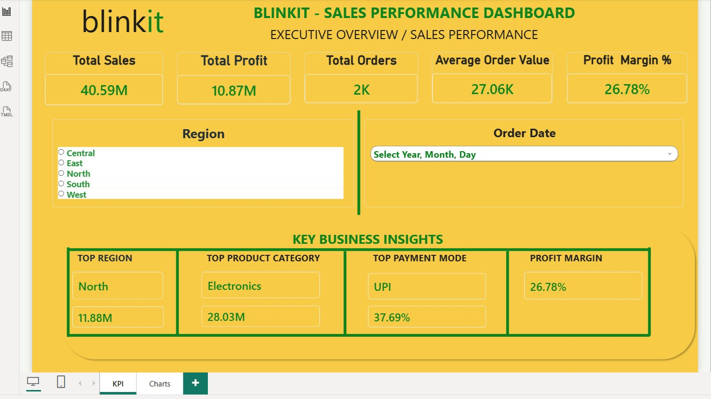
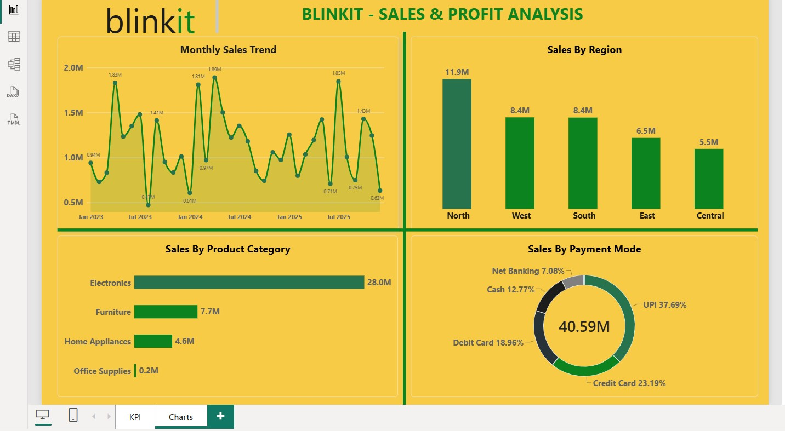

# Blinkit Sales Performance Dashboard

## Project Overview
An interactive Power BI dashboard developed to analyse Blinkit's sales performance and business insights.

## Dashboard Preview

### KPI Overview

### Sales Analysis

## Skills Demonstrated
- Power BI
- Power Query
- DAX
- Data Cleaning
- Data Visualization
- Business Intelligence
- Data Cleaning and Transformation
- Data Modelling
- DAX Measures
- KPI Development
- Interactive Dashboard Design
- Business Data Analysis

## Tools Used
- Microsoft Power BI
- Power Query
- DAX
- Data Visualization

## Dashboard Features
- Total Sales
- Total Profit
- Total Orders
- Average Order Value
- Profit Margin
- Sales by Region
- Sales by Category
- Monthly Sales Trend
- Interactive Region and Date Filters

## Project Files
- Power BI Dashboard (.pbix)
- Dashboard Screenshots
- Project Documentation

## Author
Abhishek Kumar
## Project Status
Completed

